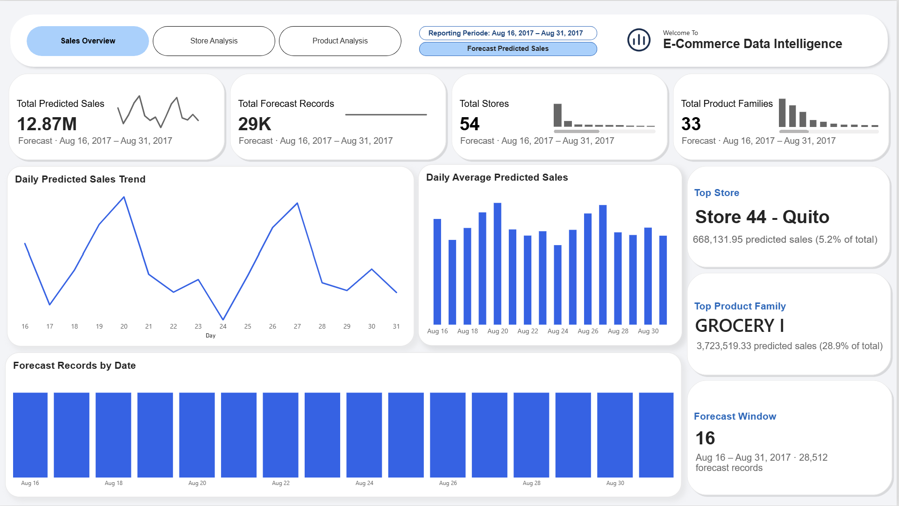
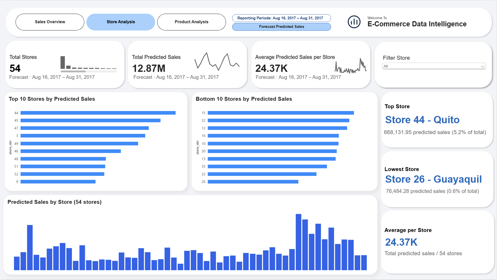
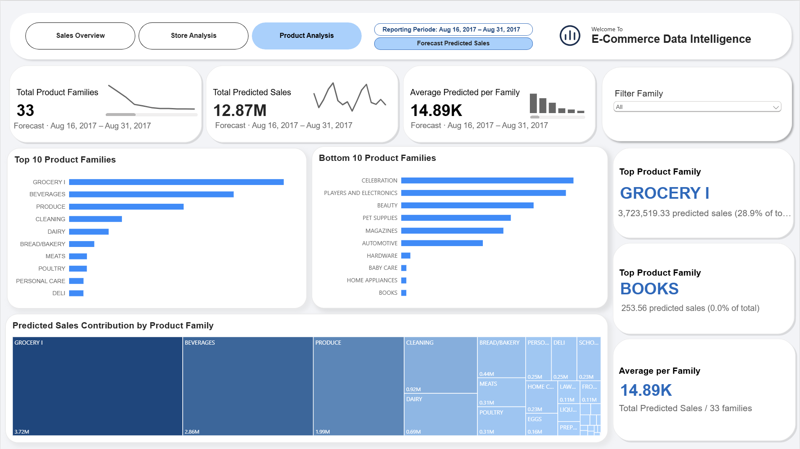

# E-Commerce Data Intelligence Platform

An end-to-end Data Engineering and Machine Learning project for grocery sales forecasting, streaming data processing, analytical data warehousing, and business intelligence.

## Project Overview

This project implements an end-to-end data platform using the Corporación Favorita Grocery Sales Forecasting dataset from Kaggle.

The platform integrates batch data processing, streaming ingestion, machine learning forecasting, dimensional data warehousing, analytical transformations, workflow orchestration, and business intelligence.

The system consists of two independent data pipelines: a batch forecasting pipeline and a streaming data pipeline.

## Technology Stack

| Category | Technology |
|---|---|
| Programming | Python |
| Data Ingestion | Apache Kafka |
| Stream Processing | Apache Spark |
| Data Processing | Pandas, NumPy |
| Machine Learning | XGBoost, Scikit-learn |
| Data Warehouse | PostgreSQL |
| Data Transformation | dbt |
| Workflow Orchestration | Apache Airflow |
| Containerization | Docker |
| Business Intelligence | Power BI |
| Development | VS Code, WSL2 |

## Architecture

The platform consists of two main processing pipelines.

### 1. Batch Forecasting Pipeline

Kaggle Dataset → Python Data Ingestion → Feature Engineering → XGBoost Training → Recursive Forecasting → PostgreSQL → dbt → Analytical Data Marts → Power BI

Apache Airflow orchestrates the batch forecasting workflow, from data ingestion to analytical data quality testing.

### 2. Streaming Data Pipeline

Sales Dataset → Kafka Producer → Apache Kafka → Spark Structured Streaming → Aggregation → PostgreSQL Streaming Table

The streaming pipeline runs independently from the current Airflow batch DAG.

Both pipelines use PostgreSQL for data storage, with separate tables for forecast data and streaming aggregation results.

For the detailed architecture, see [System Architecture](docs/architecture.md).

## Key Features

- Historical sales data exploration and profiling.
- Feature engineering with lag and rolling-window features.
- XGBoost-based sales forecasting.
- Recursive multi-step forecasting.
- Kafka-based streaming ingestion.
- Spark Structured Streaming and aggregation.
- PostgreSQL dimensional data warehouse.
- dbt staging models and analytical data marts.
- Airflow orchestration for the batch forecasting pipeline.
- Automatic task retries and failure handling.
- Forecast output validation and data quality checks.
- Pipeline execution monitoring.
- Power BI analytical dashboards.

## Forecasting Results

The forecasting pipeline generates:

| Metric | Result |
|---|---:|
| Forecast Records | 28,512 |
| Stores | 54 |
| Product Families | 33 |
| Forecast Dates | 16 |
| Forecast Period | August 16–31, 2017 |
| Total Predicted Sales | 12,868,054.18 |

The forecast results are loaded into PostgreSQL and transformed into three analytical data marts:

- `mart_sales_by_store`
- `mart_sales_by_family`
- `mart_daily_sales`

All three data marts are built from the same forecast dataset and provide different analytical perspectives.

## Data Warehouse

The PostgreSQL warehouse uses dimensional modeling with:

### Dimensions

- `dim_store`
- `dim_date`
- `dim_family`

### Fact Table

- `fact_sales_forecast`

The streaming pipeline stores its aggregation results separately in a dedicated PostgreSQL streaming table.

## Business Intelligence

Power BI is used to visualize the analytical data produced by the PostgreSQL data warehouse.

The dashboard connects directly to PostgreSQL and uses the three dbt analytical data marts.

## Power BI Dashboard Preview

### Sales Overview


### Store Analysis


### Product Analysis


For more details, see [Power BI Documentation](powerbi/README.md).

### Dashboard Views

| Dashboard | Description |
|---|---|
| Sales Overview | Overview of sales forecasting results |
| Store Analysis | Sales forecast analysis across stores |
| Product Analysis | Sales forecast analysis across product families |

Dashboard screenshots and the Power BI project file are available in the `powerbi/` directory.

## Workflow Orchestration and Monitoring

Apache Airflow orchestrates the batch forecasting pipeline through the DAG:

`ecommerce_data_pipeline`

The DAG consists of 10 tasks:

1. Start pipeline.
2. Validate project files.
3. Execute data ingestion.
4. Prepare machine learning features.
5. Train the forecasting model.
6. Generate recursive forecasts.
7. Load forecasts into PostgreSQL.
8. Execute dbt transformations.
9. Execute dbt data quality tests.
10. Finish pipeline.

### Reliability Features

- Two automatic retries per task.
- Two-minute retry delay.
- Task failure callback.
- Task execution logging.
- Required project file validation.
- Forecast output verification.
- Pipeline execution monitoring.

A standalone monitoring script, `monitor_pipeline.py`, retrieves the latest Airflow DAG run and summarizes task execution status and duration.

## Project Structure

```text
ecommerce-data-intelligence/
├── dags/
├── data/
│   ├── raw/
│   ├── staging/
│   └── processed/
├── data_science/
│   ├── notebooks/
│   └── models/
├── docs/
│   └── architecture.md
├── ecommerce_analytics/
│   └── models/
│       ├── staging/
│       └── marts/
├── infrastructure/
├── powerbi/
│   ├── Ecommerce_Sales_Intelligence.pbix
│   ├── README.md
│   ├── sales_overview.png
│   ├── store_analysis.png
│   └── product_analysis.png
├── scripts/
├── src/
│   ├── database/
│   ├── ingestion/
│   └── processing/
├── tests/
├── warehouse/
│   └── sql/
├── monitor_pipeline.py
├── docker-compose.yml
├── docker-compose.kafka.yml
├── requirements.txt
├── requirements-dbt.txt
└── README.md
```

## Getting Started

### 1. Clone the Repository

```bash
git clone https://github.com/SSgream/ecommerce-data-intelligence.git
cd ecommerce-data-intelligence
```

### 2. Create a Python Environment

```bash
python3 -m venv .venv
source .venv/bin/activate
```

### 3. Install Dependencies

```bash
pip install -r requirements.txt
```

For dbt:

```bash
pip install -r requirements-dbt.txt
```

### 4. Configure Environment Variables

Copy the example environment file:

```bash
cp .env.example .env
```

Configure the required Kaggle and PostgreSQL credentials in `.env`.

### 5. Start PostgreSQL

```bash
docker compose up -d
```

### 6. Start Kafka Infrastructure

```bash
docker compose -f docker-compose.kafka.yml up -d
```

### 7. Run the Data Pipeline

The batch forecasting pipeline is orchestrated using Apache Airflow.

The DAG executes:

1. Project file validation.
2. Data ingestion.
3. Feature preparation.
4. Model training.
5. Recursive forecasting.
6. Forecast loading into PostgreSQL.
7. dbt transformations.
8. dbt data quality tests.

The Kafka and Spark streaming pipeline is executed separately using its respective producer and consumer scripts.

For a complete setup, configure the required Python environments, Airflow, PostgreSQL, Kafka, and Spark according to the project configuration.

## Data Source

Dataset: [Corporación Favorita Grocery Sales Forecasting](https://www.kaggle.com/competitions/store-sales-time-series-forecasting)

The dataset is provided by Kaggle and is subject to its original terms and conditions.

## Documentation

- [System Architecture](docs/architecture.md)
- [Power BI Dashboard Documentation](powerbi/README.md)

## Project Status

**Core pipeline implementation completed.**

The batch forecasting pipeline, Kafka ingestion, Spark stream processing, PostgreSQL warehouse loading, dbt transformations, and Airflow orchestration have been implemented and executed.

The project also includes forecast validation, pipeline reliability mechanisms, execution monitoring, and Power BI analytical dashboards.

## Author

Selwin

Data Engineering | Machine Learning | Analytics
