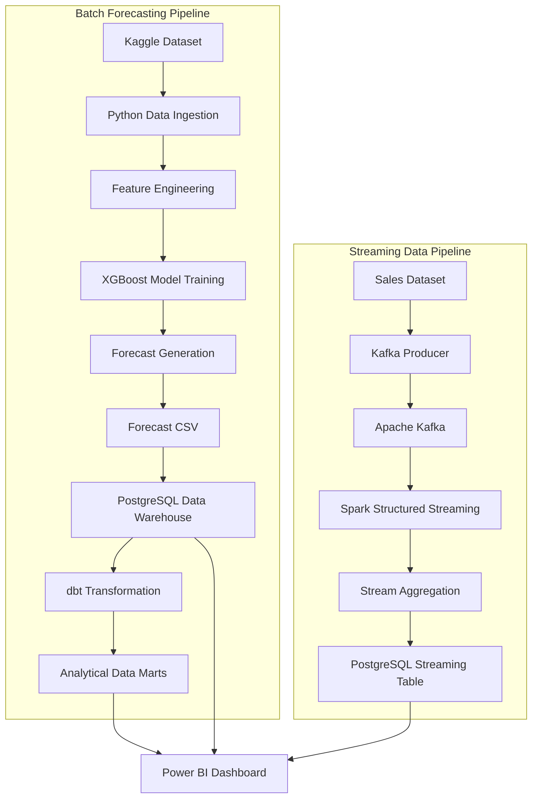
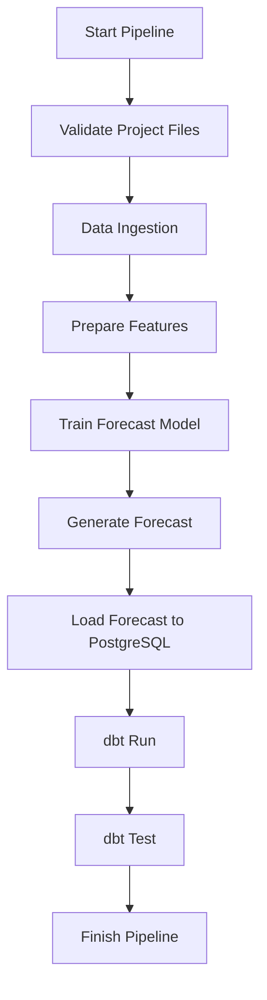
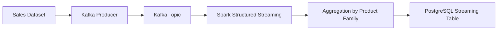

# System Architecture

## 1. Project Overview

E-Commerce Data Intelligence Platform is an end-to-end Data Engineering and Machine Learning project built using the Corporación Favorita Grocery Sales Forecasting dataset from Kaggle.

The platform demonstrates an integrated data workflow covering batch data ingestion, feature engineering, machine learning forecasting, data warehousing, analytical transformation, real-time streaming, and workflow orchestration.

The system is divided into two primary pipelines:

1. Batch Forecasting Pipeline
2. Streaming Data Pipeline

Both pipelines use PostgreSQL as their data storage platform, while Apache Airflow orchestrates the batch forecasting workflow.

## 2. Technology Stack

| Component | Technology | Purpose |
|---|---|---|
| Data Source | Kaggle | Historical grocery sales dataset |
| Programming | Python | Pipeline development |
| Batch Processing | Pandas, NumPy | Data cleaning and feature engineering |
| Machine Learning | XGBoost, Scikit-learn | Sales forecasting |
| Message Broker | Apache Kafka | Streaming event ingestion |
| Stream Processing | Apache Spark | Structured streaming and aggregation |
| Data Warehouse | PostgreSQL | Store dimensional and forecast data |
| Data Transformation | dbt | Build analytical data marts |
| Workflow Orchestration | Apache Airflow | Orchestrate batch pipeline execution |
| Containerization | Docker | Run infrastructure services |
| Business Intelligence | Power BI | Analytical dashboards |

## 3. Overall System Architecture

The platform consists of two independent processing workflows that store their results in PostgreSQL.

### Architecture Diagram

### Workflow Orchestration

Apache Airflow manages the execution sequence of the batch forecasting pipeline.

The streaming pipeline is executed separately and is not part of the current Airflow DAG.

## 4. Batch Forecasting Pipeline

The batch pipeline processes historical sales data to generate future sales predictions.

### Workflow

1. Retrieve historical sales and supporting datasets from Kaggle.
2. Ingest and prepare raw datasets using Python.
3. Perform data cleaning and feature engineering.
4. Generate lag and rolling-window features.
5. Train an XGBoost regression model.
6. Generate recursive sales forecasts.
7. Save forecast results as a CSV file.
8. Load forecast records into PostgreSQL.
9. Transform warehouse data using dbt.
10. Validate analytical models using dbt tests.

### Feature Engineering

The feature engineering process prepares historical sales information and supporting attributes for machine learning.

The generated features include:

- Historical sales lag features.
- Rolling-window statistics.
- Date-related features.
- Store-related attributes.
- Product family attributes.

### Forecasting

XGBoost is used as the regression model to predict future sales.

The forecasting process uses recursive multi-step prediction to generate forecasts for the test period.

The resulting forecast dataset is saved and validated before being loaded into PostgreSQL.

## 5. Streaming Data Pipeline

The streaming pipeline demonstrates event ingestion and stream processing using Apache Kafka and Apache Spark.

### Workflow

1. Read sales records from the historical dataset.
2. Publish sales records using a Kafka producer.
3. Store streaming events in an Apache Kafka topic.
4. Consume events using Spark Structured Streaming.
5. Aggregate streaming records by product family.
6. Store aggregation results in PostgreSQL.

### Architecture Diagram

The streaming pipeline is maintained separately from the batch forecasting DAG.

## 6. Data Warehouse Design

PostgreSQL serves as the central data warehouse for the platform.

The batch forecasting pipeline uses dimensional modeling to organize sales forecast data.

### Dimension Tables

| Table | Description |
|---|---|
| `dim_store` | Store attributes, including city, state, type, and cluster |
| `dim_date` | Calendar attributes for time-based analysis |
| `dim_family` | Product family information |

### Fact Table

| Table | Description |
|---|---|
| `fact_sales_forecast` | Predicted sales at date, store, and product-family grain |

### Streaming Table

The streaming pipeline stores aggregated streaming results in a separate PostgreSQL table.

This separation allows batch forecast data and streaming aggregation data to be maintained independently.

## 7. Analytical Data Transformation

dbt transforms warehouse data into structured analytical models.

### Staging Models

- `stg_sales_forecast`
- `stg_stores`
- `stg_dates`
- `stg_families`

### Analytical Data Marts

| Model | Description |
|---|---|
| `mart_sales_by_store` | Sales forecast aggregation by store |
| `mart_sales_by_family` | Sales forecast aggregation by product family |
| `mart_daily_sales` | Daily sales forecast aggregation |

dbt tests validate data quality and relationships between analytical models.

## 8. Workflow Orchestration

Apache Airflow orchestrates the batch forecasting pipeline through a Directed Acyclic Graph (DAG).

DAG ID: `ecommerce_data_pipeline`

### Task Sequence

| Order | Task ID | Description |
|---:|---|---|
| 1 | `start_pipeline` | Start workflow |
| 2 | `validate_project_files` | Validate required files and executables |
| 3 | `data_ingestion` | Execute dataset ingestion |
| 4 | `prepare_features` | Prepare machine learning features |
| 5 | `train_forecast` | Train XGBoost model |
| 6 | `generate_forecast` | Generate sales predictions |
| 7 | `load_forecast` | Load predictions into PostgreSQL |
| 8 | `dbt_run` | Execute dbt transformations |
| 9 | `dbt_test` | Execute data quality tests |
| 10 | `finish_pipeline` | Mark workflow completion |

### Reliability and Monitoring

The Airflow pipeline implements:

- Automatic retries with two retries per task.
- Two-minute retry delay.
- Task failure callback.
- Centralized task logging through Airflow.
- Required project file validation.
- Pipeline execution monitoring.
- Task-level execution status and duration monitoring.

A standalone monitoring script, `monitor_pipeline.py`, retrieves the latest DAG run and displays task execution results.

## 9. Data Validation

The project implements validation at multiple stages.

### Forecast Validation

- Required input column validation.
- Model feature compatibility validation.
- Forecast record count validation.
- Duplicate record detection.
- Missing value validation.
- Negative prediction validation.
- Saved forecast file verification.

### Data Warehouse Validation

- Dimension reference validation.
- Fact table consistency checks.
- Analytical data mart aggregation validation.
- dbt schema tests.
- dbt relationship tests.

These validation processes help maintain data quality throughout the pipeline.

## 10. Forecasting Output

The forecasting pipeline generates 28,512 predictions covering:

| Metric | Result |
|---|---:|
| Forecast Records | 28,512 |
| Stores | 54 |
| Product Families | 33 |
| Forecast Dates | 16 |
| Forecast Period | August 16–31, 2017 |
| Total Predicted Sales | 12,868,054.18 |

The forecast results are stored in PostgreSQL and exposed through three dbt analytical data marts.

## 11. Business Intelligence

Power BI is used as the visualization and business intelligence layer of the platform.

The Power BI dashboard connects directly to PostgreSQL to retrieve data from three analytical data marts created using dbt.

The dashboard contains three analytical views:

1. **Sales Overview** — provides an overview of sales forecasting results.
2. **Store Analysis** — presents sales forecast analysis across stores.
3. **Product Analysis** — presents sales forecast analysis across product families.

The analytical data marts in PostgreSQL serve as the data source for the Power BI dashboards.
