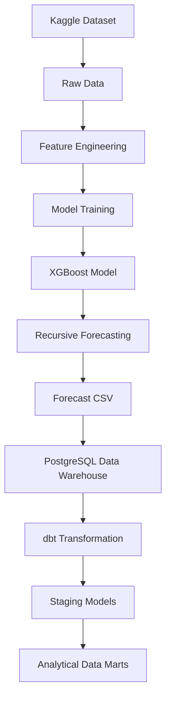
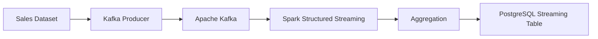

# System Architecture

## 1. Project Overview

E-Commerce Data Intelligence Platform is an end-to-end data engineering and machine learning project built using the Corporacion Favorita Grocery Sales Forecasting dataset.

The platform demonstrates batch data processing, real-time streaming, machine learning forecasting, data warehousing, analytical transformation, and workflow orchestration.

## 2. Technology Stack

| Component | Technology | Purpose |
|---|---|---|
| Data Source | Kaggle | Grocery sales dataset |
| Data Ingestion | Python, Apache Kafka | Batch and streaming ingestion |
| Stream Processing | Apache Spark | Process streaming records |
| Data Processing | Python, Pandas, NumPy | Data cleaning and feature engineering |
| Machine Learning | XGBoost, Scikit-learn | Sales forecasting |
| Data Warehouse | PostgreSQL | Store dimensions and forecast facts |
| Data Transformation | dbt | Build analytical data marts |
| Workflow Orchestration | Apache Airflow | Orchestrate batch pipeline |
| Containerization | Docker | Run infrastructure services |

## 3. Overall Architecture

The platform consists of two main data pipelines:

1. Batch forecasting pipeline.
2. Streaming data pipeline.

Both pipelines use PostgreSQL as their data storage platform, with separate tables for forecast data and streaming results.

## 4. Batch Forecasting Pipeline

The batch pipeline processes historical sales data and generates future sales forecasts.

### Workflow

1. Load historical sales and supporting datasets from Kaggle.
2. Perform data exploration and feature engineering.
3. Generate historical lag and rolling-window features.
4. Train an XGBoost regression model.
5. Generate recursive forecasts for future dates.
6. Load forecast results into PostgreSQL.
7. Transform warehouse data using dbt.
8. Validate analytical data marts.

### Architecture Diagram

## 5. Streaming Data Pipeline

The streaming pipeline demonstrates event ingestion and stream processing using Apache Kafka and Apache Spark.

### Workflow

1. Read sales records from the historical dataset.
2. Publish records to an Apache Kafka topic.
3. Consume streaming records using Spark Structured Streaming.
4. Aggregate records by product family.
5. Store streaming aggregation results in PostgreSQL.

### Architecture Diagram

## 6. Data Warehouse Design

The PostgreSQL data warehouse uses a dimensional modeling approach.

### Dimension Tables

- `dim_store`: Store information, including city, state, type, and cluster.
- `dim_date`: Calendar attributes used for time-based analysis.
- `dim_family`: Product family information.

### Fact Table

- `fact_sales_forecast`: Stores predicted sales at the date, store, and product-family grain.

### Streaming Table

The streaming pipeline uses a separate table to store aggregated streaming results.

## 7. Analytical Data Transformation

dbt transforms warehouse data into analytical models.

### Staging Models

- `stg_sales_forecast`
- `stg_stores`
- `stg_dates`
- `stg_families`

### Data Marts

- `mart_sales_by_store`: Sales forecast aggregation by store.
- `mart_sales_by_family`: Sales forecast aggregation by product family.
- `mart_daily_sales`: Daily sales forecast aggregation.

dbt tests are used to validate data quality and model relationships.

## 8. Workflow Orchestration

Apache Airflow orchestrates the batch forecasting pipeline.

The DAG consists of the following tasks:

1. `validate_project_files`
2. `prepare_features`
3. `train_forecast`
4. `generate_forecast`
5. `load_forecast`
6. `dbt_run`
7. `dbt_test`

The Kafka and Spark streaming pipeline is executed separately from this Airflow DAG.

## 9. Data Validation

The project implements several validation processes:

- Forecast record count validation.
- Duplicate record detection.
- Missing value validation.
- Negative prediction validation.
- Warehouse dimension reference validation.
- dbt schema and relationship tests.
- Analytical data mart aggregation consistency checks.

## 10. Forecasting Output

The forecasting pipeline generates 28,512 predictions covering:

- 54 stores.
- 33 product families.
- 16 forecast dates.

Forecast period: August 16–31, 2017.

The forecast results are stored in PostgreSQL and exposed through dbt analytical data marts.
